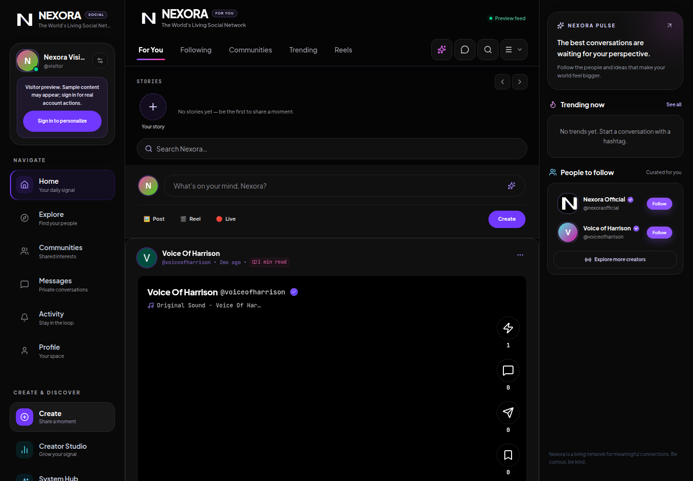
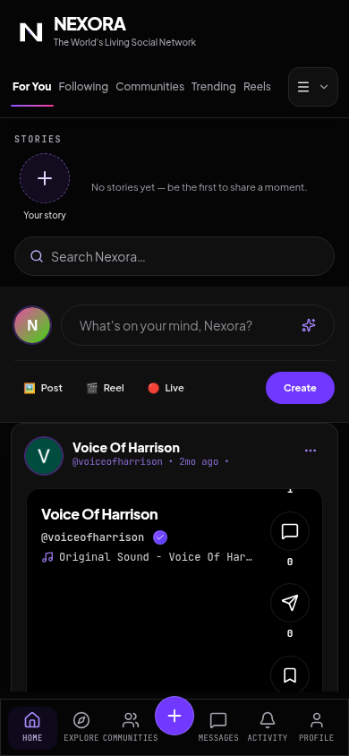

# Nexora security, reliability, and product-integrity report

**Scope:** current `main` checkout, application and Functions source, Firestore/Storage rules, legacy-public-post migration tooling, VOH API, messaging media, trusted engagement, wallet claims, and the visual baseline. No production write, migration, rules deployment, Functions deployment, or application deployment was performed. The retained preview screenshots show only the public feed; no private profile, chat, or media content was accessed.

## Implemented protections and product corrections

- Firestore profile/public-profile creation rejects forged verification, reputation, initial engagement, and privileged account claims; user updates are allowlisted. Sensitive user-owned state and message writes are bounded by explicit rules. Shared posts must carry explicit `audience: "public"`; feed queries filter to that value, with the required chronological index. Unsupported private audiences remain disabled.
- A reviewed-ID, dry-run-first, resumable public-audience migration is implemented and tested. It never infers that an unlabelled post is public. The checked-in manifest is only a template; no production migration has run.
- The trusted post-like operation authenticates through a callable and uses a Firestore transaction to set the caller's private like marker and update the post counter idempotently. It creates the recipient's notification only when a real like changes state; repeat requests do not duplicate events.
- Follow/community access and public-community queries are constrained. Owner-only media writes/read/delete enforce MIME, size, and path metadata. **Private chat audio no longer uses permanent download URLs or direct client Storage access.** Authenticated API upload checks chat membership in the configured Firestore database, enforces a size/MIME limit and per-user rate quota, stores a private object path, and playback verifies membership plus a message reference before returning a no-store byte stream. Account deletion removes the user's chat audio in bounded pages before removing their participant state.
- New browser voice notes store only the private object path. Playback requires an explicit user action, is fetched with a Firebase ID token, and uses a temporary revocable browser object URL. Simulated microphone-failure audio and fake attachment payloads were removed. Optional codec suffixes from browser `MediaRecorder` MIME strings are normalized before allow-list validation.
- VOH endpoints require Firebase ID tokens, enforce a shared per-user Firestore rate limit and bounded payloads, and return honest unavailable errors rather than synthetic success. Local chat history and opted-in memory are isolated by authenticated account.
- Wallet/creator screens do not claim a balance, exchange rate, payout, or transaction as real without a trusted ledger. Real transfers and payouts remain disabled; no payment provider or ledger was configured.
- The app mark and PWA SVG now share a high-contrast white geometric N with a single restrained violet detail, without gradients or glow. The black/white/violet system and responsive feed refinements were retained.

## Validation completed

| Check | Outcome |
|---|---|
| Root TypeScript (`npm run lint`) | Passed |
| Firebase Functions TypeScript build (`npm run functions:build`) | Passed |
| Unit tests (`npm run test:unit`) | 12 passed, 0 failed |
| Firestore authorization Emulator (`npm run test:rules`) | 17 passed, 0 failed |
| Storage authorization Emulator (`npm run test:storage`) | 2 passed, 0 failed |
| Reviewed audience migration Emulator (`npm run test:migration`) | 4 passed, 0 failed |
| Trusted engagement Emulator (`npm run test:engagement`) | 3 passed, 0 failed |
| VOH/auth/private-media HTTP Emulators (`npm run test:voh-security`) | 5 passed, 0 failed; includes participant denial, no-download-URL assertion, message-reference gating, and no-store stream check |
| Root production build (`npm run build`) | Passed after the final code-splitting change |
| Firebase Functions build (`npm run functions:build`) | Passed after the final changes |
| Dependency audits (`npm audit --omit=dev`; Functions production audit) | 0 known vulnerabilities in either dependency set |
| Final UI evidence | Captured stable desktop (1440×1000) and mobile (390×844) guest-preview screenshots; files are linked below |

The production build still warns that the JavaScript entry chunk exceeds 500 kB: it is 1,506.31 kB (395.95 kB gzip). Lazy-loading the 3,685-line `FeedView` moved it into its own 130.36 kB chunk and reduced the entry by 261.34 kB raw (66.59 kB gzip) versus the preceding build. Additional splitting may be worthwhile, but the warning is not fully resolved. Emulator tests use synthetic/demo projects and do not prove live deployment behavior.

## Deployment and remaining production work

1. **Nothing in this checkout is deployed.** Confirm the intended Firebase project, authorized operator, backed-up rules/data, indexes, and a change window before deploying. Production currently has not been modified.
2. **Named-database boundary:** the app is configured for project `evident-server-bqmt3`, named database `ai-studio-nexora-29627584-4036-4cc0-b743-61fab6f219f8`, and bucket `evident-server-bqmt3.firebasestorage.app`. The private-media HTTP integration suite exercised the same authorization logic in emulators using `(default)` plus an emulator bucket; it did not connect to the production named database or bucket. Confirm Firestore Admin access to that database, Storage service-account permissions, and deployed environment values before rollout. Firebase Storage Rules cross-service lookup documentation uses the default Firestore database; see [`docs/FIREBASE_NAMED_DATABASE_LIMITATION.md`](docs/FIREBASE_NAMED_DATABASE_LIMITATION.md). The API proxy intentionally avoids relying on Storage Rules to resolve named-database chat membership.
3. Firebase's local Firestore Emulator warns that it does not model multiple databases. Rules tests explicitly install and exercise the source rules in the emulator test environment, but named-database deployment behavior requires a reviewed non-production Firebase project smoke test before any production rollout.
4. Before strict public-feed rules are deployed, an authorized reviewer must produce and independently review the confirmed-public legacy-ID manifest. Run the documented dry-run, obtain explicit change approval, apply only under the guarded production migration flow, then verify counts and a small reviewed sample. Do not promote ambiguous/restricted records.
5. No trusted NEX monetary or non-monetary ledger, payment provider, webhook verification, settlement/reconciliation, or live transfer system exists. Keep those features unavailable until designed, implemented, tested, and reviewed.
6. Private audiences (followers, circles, close friends, community-only) remain intentionally unavailable. General published post media still uses Firebase download-token URLs by design; keep such media public-only and do not reuse those URLs for private content.
7. Verify production authentication-provider settings, authorized domains, Gemini secret configuration, App Check policy, Functions runtime/region, TTL cleanup, monitoring/alerts, and account-deletion behavior in the intended project. None were live-smoke-tested here.
8. Review performance/bundle splitting and independently smoke-test feed, profile, follow, comment, and message flows against a non-production Firebase project before treating the repository as production-ready.

See [`docs/FIREBASE_DEPLOYMENT_RUNBOOK.md`](docs/FIREBASE_DEPLOYMENT_RUNBOOK.md) for the migration/deployment sequence and rollback guidance. Repository validation is not a substitute for production deployment verification.
